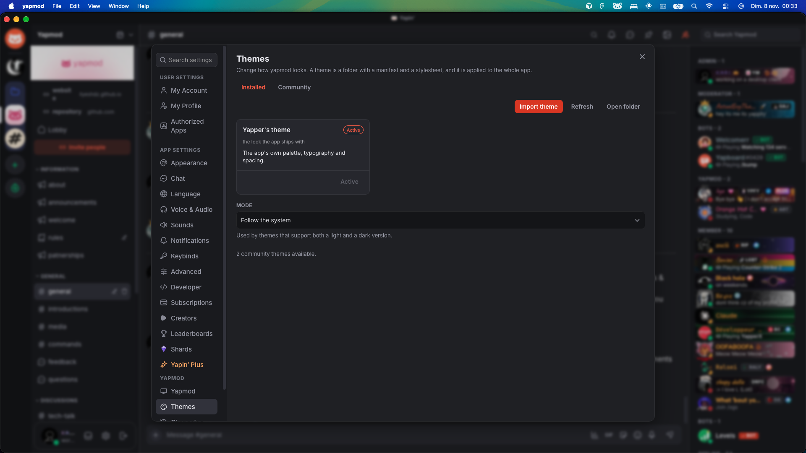
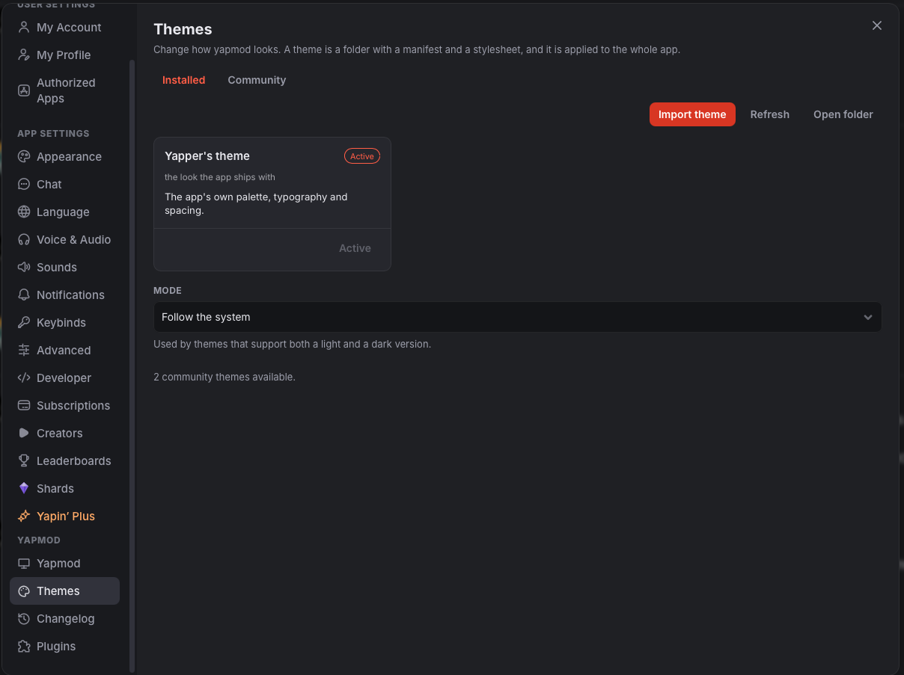

  
  <h1>yapmod</h1>
  
A free and open-source desktop app for <a href="https://www.yapin.gg">Yapin</a> that lets you customize the way it looks and works.

  

    
    
    
  

---

A lightweight desktop client for Yapin that you can shape to fit how you use it. Add themes, install plugins, keep things running in the background. Everything stays on your machine.

> An independent community project, not affiliated with Yapin.

## Themes

Change how Yapin looks. Browse the [community catalog](https://ilyeshdz.github.io/yapmod/docs/) for ready-made themes or write your own with CSS.

Themes are CSS-only and installed locally. Your settings never leave your computer.

## Plugins

Plugins let you extend the app with new features, remove things you don't need, or change how certain parts work. They're easy to toggle on and off.

The plugin system supports things like auto-dismissing popups, custom backgrounds, keyboard shortcuts, and UI tweaks. Browse or submit plugins on the [community catalog](https://ilyeshdz.github.io/yapmod/docs/).

## A smaller footprint

yapmod uses the webview your system already has instead of bundling a full browser, so the download is small and it uses less memory.

## Installation

Download the latest build from the [Releases](https://github.com/ilyeshdz/yapmod/releases) page:

| Platform | Format |
|----------|--------|
| **Windows** | `.exe` installer, `.msi`, or portable `.zip` |
| **macOS** | `.dmg` (Apple Silicon and Intel) |
| **Linux** | `.AppImage`, `.deb`, `.rpm`, or portable `.tar.gz` |

Want to try changes before they ship? Grab the [nightly build](https://github.com/ilyeshdz/yapmod/releases/tag/nightly). It updates daily and might be unstable.

> **macOS:** builds are ad-hoc signed but not notarized. On first launch, right-click the app and choose **Open**, or allow it in **System Settings → Privacy & Security**.

## Documentation

Installation guides, theme and plugin tutorials, and troubleshooting live at [ilyeshdz.github.io/yapmod/docs](https://ilyeshdz.github.io/yapmod/docs/).

## Community

Join the official Yapin server: [yapin.gg/invite/yapmod](https://www.yapin.gg/invite/yapmod)

## Contributing

Contributions are welcome. For bigger changes, open an issue first so we can talk about the approach. Keep pull requests focused.

See [CONTRIBUTING.md](CONTRIBUTING.md) for details.

---

  
Unofficial project · Not affiliated with Yapin

